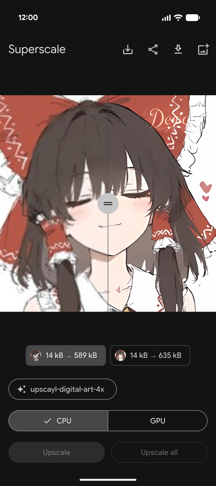
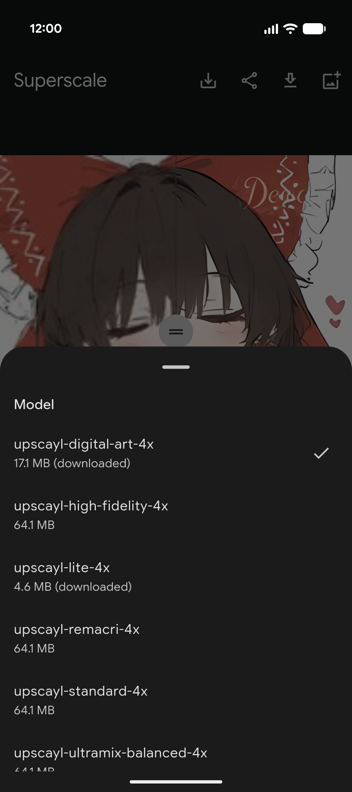

# Superscale

Minimal Android AI image upscaler

<p align="center">
  
  
</p>

## Features

- Native C engine over FFI with CPU and GPU backends
- CPU inference through multithreaded ONNX Runtime
- GPU inference through native Vulkan compute shaders
- Upscayl model ecosystem
- Interactive split comparison slider
- Batch queue processing with per-tile progress and cancel
- Material You dynamic color
- Zero telemetry, server uploads, or image retention

## Android

You can download Superscale from the [Releases](https://github.com/vzpyr/superscale/releases).

## Build

You need the Flutter SDK, Android SDK, and JDK.

```bash
flutter build apk --debug
```

The APK will afterwards land in `build/app/outputs/flutter-apk/`. It targets `arm64-v8a` only.

## License

[MIT](LICENSE)
